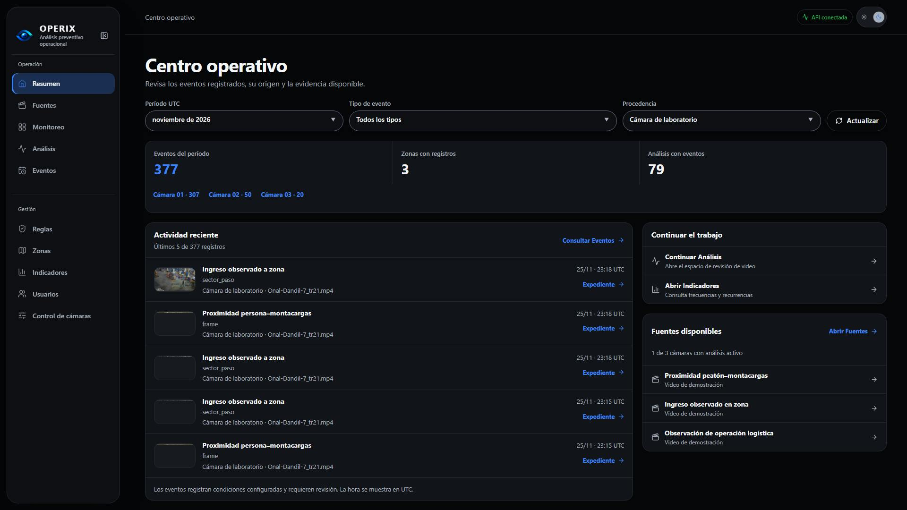
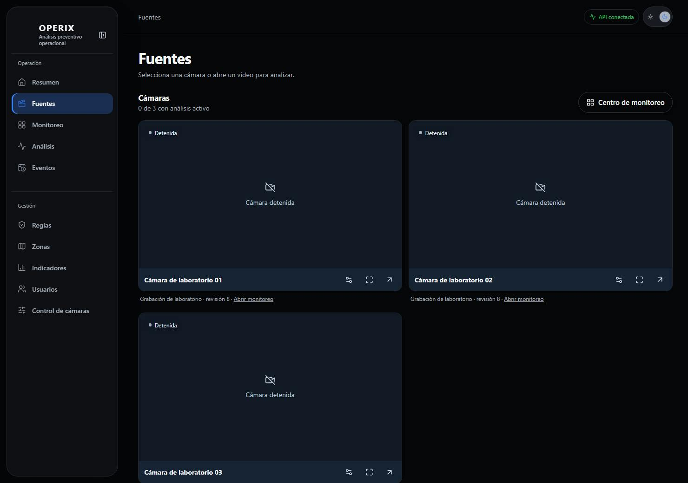
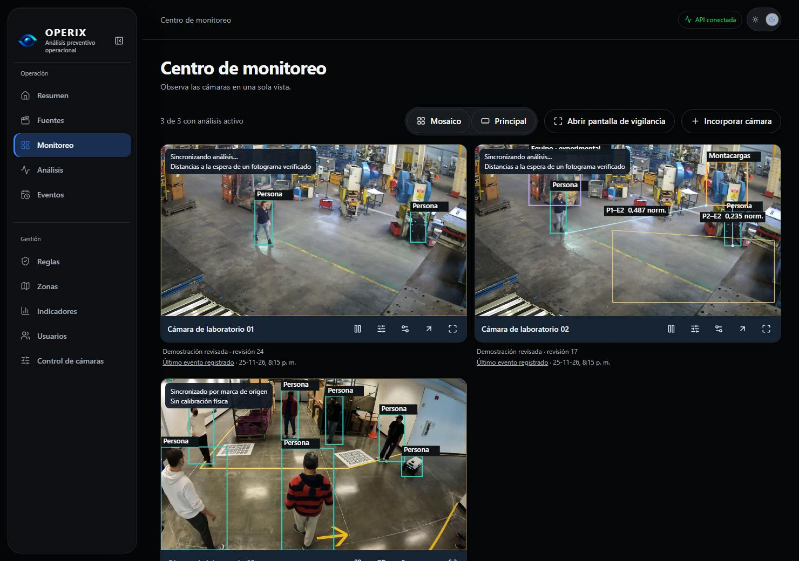
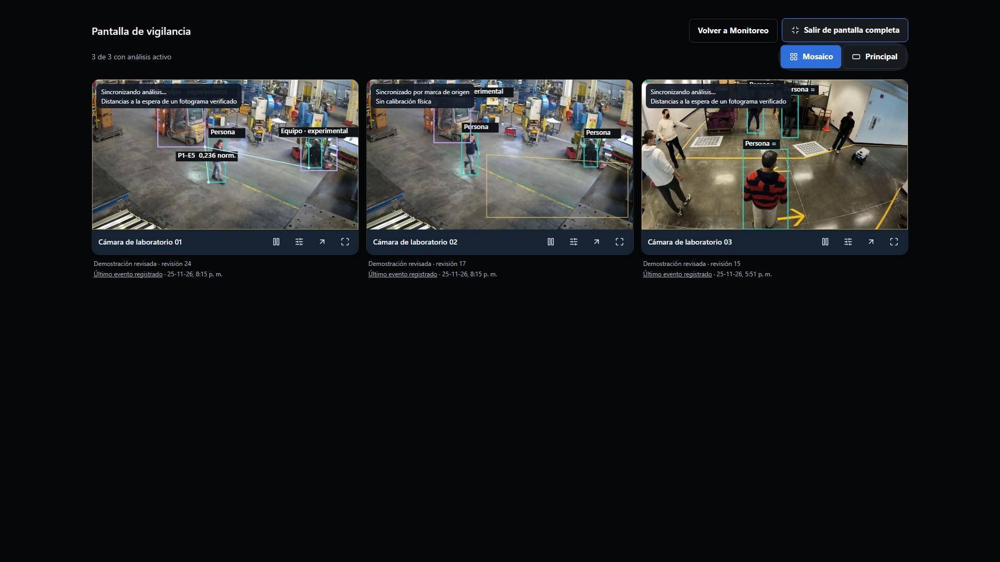
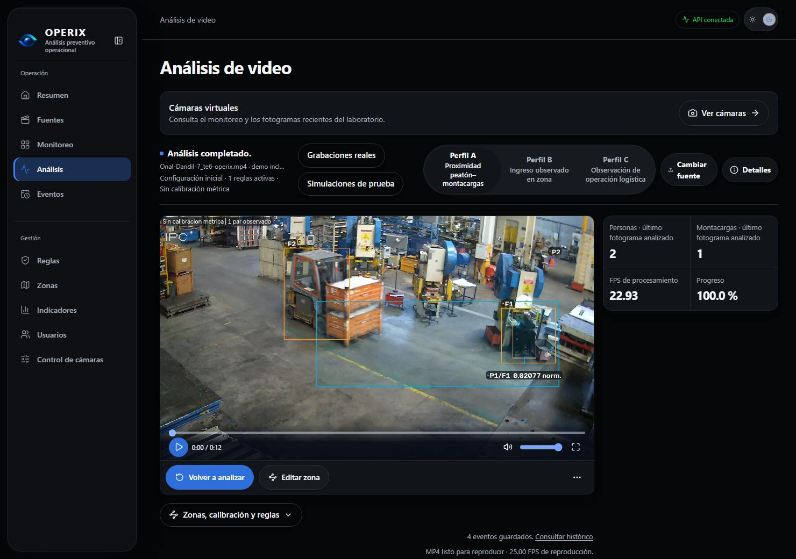
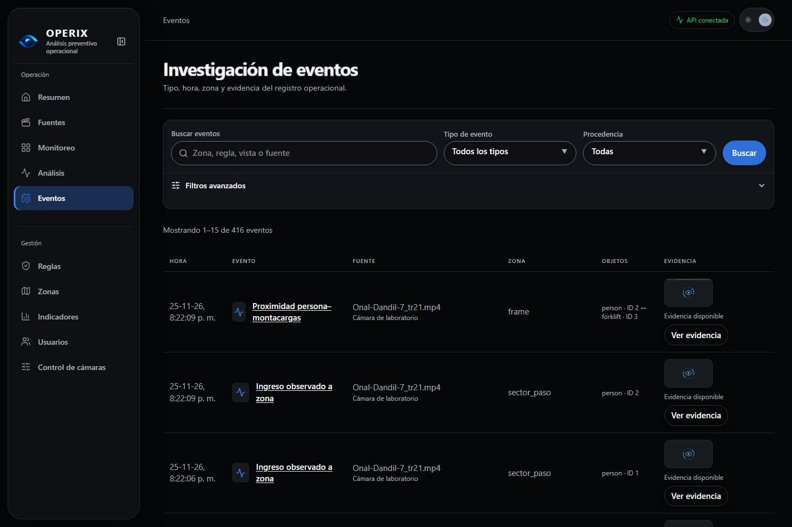
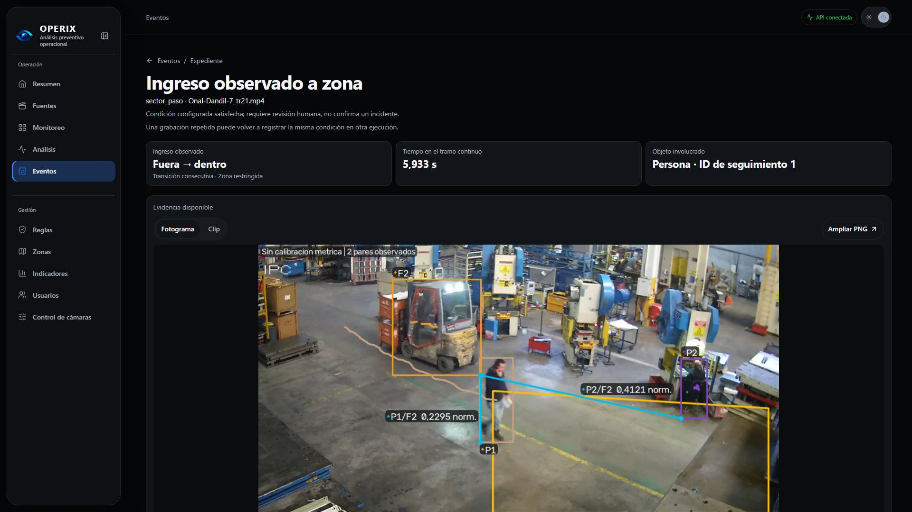
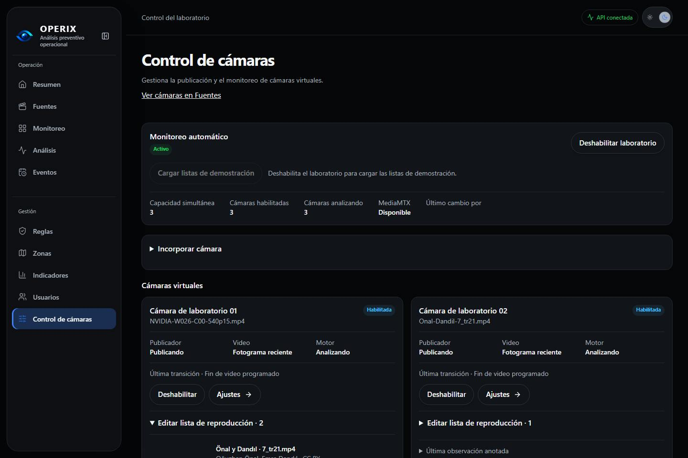
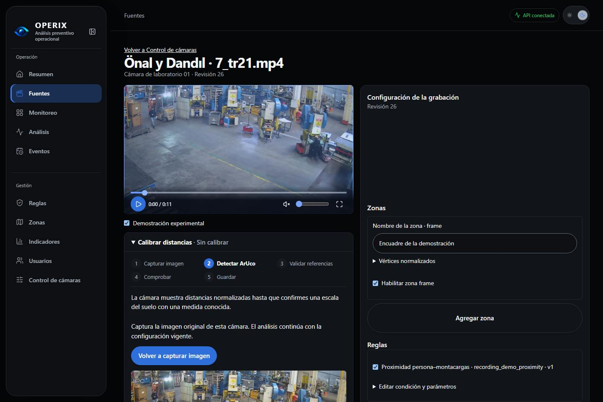

# Operix

Aplicación académica de análisis preventivo de video industrial. Integra detección,
seguimiento, reglas configurables y evidencia para revisión humana.

**Video → detector → tracking → variables espacio-temporales → reglas → evento → evidencia.**

Un evento indica que se satisfizo una condición configurada. Requiere revisión humana
para determinar qué ocurrió.

## Demostración

1. En [Operix local](http://127.0.0.1:13000), inicia sesión y abre **Análisis**.
   **Grabaciones reales** ofrece proximidad (A), ingreso observado (B) y
   observación logística sin regla inicial (C). **Simulaciones de prueba**
   recupera los videos y las zonas originales A/B/C. También puedes cargar
   un archivo. [Procedencia y resultados esperados](deployment/rtsp-lab/README.md#perfiles-de-análisis-con-grabaciones-reales).
2. En **Gestión → Control de cámaras**, con el laboratorio apagado, guarda
   las listas actuales. Pulsa **Cargar listas de demostración**, confirma el
   reemplazo de las tres listas y activa el laboratorio. La opción aparece
   cuando están disponibles las grabaciones y revisiones espaciales verificadas.
   Cámara 01 reproduce «Warehouse 026 C02 → C00», con proximidad en el acceso
   al pasillo y permanencia, respectivamente. Cámara 02 reproduce
   «Warehouse 027 C05» con una regla de ingreso. Cámara 03 reproduce «Warehouse
   027 C06» como control negativo de proximidad. Las tres listas se repiten.
   Cada transición conserva su propia configuración y puede pausar la señal
   mientras se prepara la grabación siguiente. Revisa los objetos marcados
   en el expediente antes de interpretar una condición.
3. **Fuentes** muestra el inventario y sus miniaturas. **Monitoreo** muestra las
   señales activas y las condiciones registradas. Abre **Pantalla de vigilancia**
   en otra pestaña para trasladarla a un monitor externo y activar pantalla completa.
4. Abre **Eventos** o filtra el resumen por **Cámara de laboratorio**. Comprueba
   el expediente, su regla, revisión, PNG y clip. Para Embonor se conserva
   [el expediente de demostración](http://127.0.0.1:13000/events/21b68882-e49a-40cf-81c2-f2a0295ff393).
5. Devuelve las listas y el estado de las cámaras a su configuración previa.
   Los videos difíciles siguen disponibles en el catálogo para evaluación.

En instalaciones nuevas, la
[guía del laboratorio](deployment/rtsp-lab/README.md#configuración-por-grabación)
detalla cómo reproducir las revisiones de demostración. Los videos autorizados
se montan en solo lectura. Para habilitar las simulaciones, añade
`compose.simulation-demos.yaml` a Compose y monta en `/data/input` los tres
archivos de [simulación](assets/demo/README.md).

## Capturas de la aplicación

Las capturas se tomaron en Edge durante las pruebas en QA y en la instancia
local. Los conteos corresponden a esas ejecuciones sobre grabaciones autorizadas.



<details>
<summary>Fuentes, Monitoreo y pantalla de vigilancia</summary>





</details>

<details>
<summary>Análisis de archivo y revisión de evidencia</summary>





</details>

<details>
<summary>Control de cámaras, zonas y calibración</summary>




</details>

Grabaciones en las capturas de demostración. [Önal y Dandıl, CC BY 4.0](https://data.mendeley.com/datasets/xjmtb22pff/1) ·
[NVIDIA PhysicalAI SmartSpaces, CC BY 4.0](https://huggingface.co/datasets/nvidia/PhysicalAI-SmartSpaces).

## Arquitectura

- **Frontend:** Next.js, React y TypeScript. Sesiones y permisos verificados
  por Django, con la API y los medios protegidos a través del mismo origen.
- **Motor:** YOLO11m UNIFIED V7 con ONNX Runtime CUDA y ByteTrack. El perfil
  LEGACY_DUAL conserva YOLO11m PERSON y FORKLIFT especialista como alternativa.
- **Monitoreo:** FFmpeg emite el catálogo autorizado por RTSP. MediaMTX
  distribuye LL-HLS. Cada ejecución tiene su propio contexto temporal, reglas
  y calibración. El reproductor sincroniza las observaciones con la emisión.
- **Persistencia:** Django publica en PostgreSQL el evento y su snapshot.
  Volúmenes conservan PNG y clips protegidos. OpenCV y ArUco asisten la
  calibración de un plano conocido.

[Diseño arquitectónico y ADR](docs/architecture/README.md).

## Ejecución local

```powershell
git clone https://github.com/DPBascur/Operix.git
cd Operix
git switch dev
```

`dev` contiene el candidato actual; `main` se promoverá después del gate final.
`v0.1.0` conserva el hito histórico del pipeline base. **v0.2.0 está en preparación**,
sin tag ni Release publicados por esta campaña.

| Guía | Preparación |
| --- | --- |
| [Motor](engine/README.md#entorno-local) | Python 3.12, entorno Windows/CUDA o instalación CPU, pesos y scripts |
| [Backend](backend/README.md#requisitos-y-configuración) | PostgreSQL, entorno local, migraciones y API |
| [Frontend](frontend/README.md#instalación-y-ejecución) | Node 24.2.0, pnpm 11.28.2 y URL de la API |
| [Laboratorio RTSP](deployment/rtsp-lab/README.md) | Catálogo autorizado, playlists, recuperación y fallback |

Crear los entornos de cada guía y cargar las variables locales del Backend antes
de migrar/iniciar. Frontend usa `NEXT_PUBLIC_DATA_SOURCE=api`. Los pesos y archivos ONNX
verificados permanecen fuera de Git y no se descargan al arrancar.
El worker web requiere CUDA; instalar el Motor en CPU no habilita esa ruta.
El acceso requiere una cuenta de Django. Consulta [cómo crear cuentas, asignar roles y configurar el proxy](backend/README.md#acceso-y-despliegue).

Para una demo privada desde otro equipo conectado por Tailscale, ejecutar
`.\scripts\start-demo.ps1` en Windows. La [guía del frontend](frontend/README.md#demo-privada-desde-otro-equipo-por-tailscale-windows-con-gpu)
documenta el arranque nativo, acceso por el mismo origen y Firewall acotado.

El lock Windows/CUDA fija Ultralytics 8.4.146 para las evidencias correspondientes.
Una instalación genérica no fijada puede resolver otra versión compatible;
las pruebas CPU históricas no cambian los resultados del entorno fijado.

## Docker local y GPU

Docker Compose ofrece PostgreSQL, Backend/worker y Frontend como alternativa al
modo nativo. GPU NVIDIA en Windows requiere Docker Desktop/WSL2 y driver compatible.

```powershell
if (-not (Test-Path .env)) { Copy-Item .env.docker.example .env }
# Configurar secretos propios y rutas individuales de pesos en .env.
docker compose up -d --build
# Para análisis con GPU:
docker compose -f compose.yaml -f compose.gpu.yaml up -d --build
```

[Guía Docker](deployment/docker/README.md): pesos/input read-only, puertos loopback
y volúmenes propios. Los modelos no se incluyen en la imagen. La configuración CPU
levanta la infraestructura; no convierte el worker CUDA en un worker de inferencia CPU.
Para reproducir el perfil activo en la instancia de demostración, consulta la
[configuración RTSP y GPU](deployment/rtsp-lab/README.md) y su
[procedimiento de recuperación a LEGACY_DUAL](deployment/rtsp-lab/README.md#recuperar-legacy_dual).
PostgreSQL conserva eventos, configuraciones y snapshots. Los volúmenes conservan PNG y clips. Las sesiones de análisis de archivo son temporales.
**`docker compose down -v` elimina los volúmenes y sus datos.**

## Estado y límites

En una prueba de laboratorio con RTX 3070 y Ryzen 5 5500, las tres señales
de 540p se reprodujeron a 15 FPS por cámara sin descartes en tres ventanas
de 4 s de Edge a 1920 × 1080. En la corrida separada de aceptación del
puerto 13000, la mediana del Motor fue 12 FPS por cámara y el p95 local
de llegada del fotograma a resultado se situó entre 45 y 97 ms en las
muestras activas. Esta medición local excluye la distribución LL-HLS y la
presentación en el navegador.

- PERSON y FORKLIFT pueden omitirse o confundirse según el encuadre, el tamaño
  y la oclusión. PALLET_JACK se visualiza como clasificación experimental.
  Önal 7_tr21 queda en el catálogo para evaluación. En esa grabación se
  omitió una condición de proximidad entre repeticiones y se observó una
  detección FORKLIFT sobre maquinaria fija. En Warehouse 027 C05 todavía
  aparecen falsos positivos breves de FORKLIFT. Comprueba los
  objetos en el PNG y el clip. El seguimiento usa identificadores temporales
  por ejecución.
- `norm.` indica una distancia en espacio de imagen. Los metros aproximados
  requieren calibración física válida para la cámara y el plano. La
  comprobación geométrica controlada queda separada de la exactitud en terreno.
- Las cajas interpoladas son posiciones visuales estimadas. Las reglas
  espaciales se evalúan con observaciones válidas y revisiones de la fuente.
- Las repeticiones de laboratorio producen ejecuciones distintas. Los
  filtros de procedencia separan esos registros del resumen general.
- El rendimiento depende del equipo, resolución, cadencia y cantidad de
  trabajadores. La demostración verifica el recorrido funcional en condiciones
  de laboratorio y la validación operacional continúa pendiente.

<details>
<summary>PoC histórico v0.1.0 — entradas y resultado OP-34/60/61</summary>

Se conservan como antecedentes; el resultado siguiente usa el pipeline histórico
PERSON de YOLO11n y no representa la demo dual actual.

**Entrada persona–montacargas (OP-34)**

https://github.com/user-attachments/assets/93648968-ae9e-4c66-aef2-c04be7ff2bae

**Entrada warehouse fire (OP-35/60/61)**

https://github.com/user-attachments/assets/82707306-f3de-40d4-b8fd-fb3f3c292fee

**Resultado anotado histórico (OP-60/61)**

https://github.com/user-attachments/assets/1271a029-4057-421e-a13b-72baf02d08e0

[Archivos originales y guía histórica](assets/demo/README.md) ·
[Evidencia del PoC](engine/evidence/OP-61-poc.md)

</details>

## Documentación y licencia

- [Notas candidatas de v0.2.0](RELEASE_NOTES.md).
- [Índice de evidencia](engine/evidence/README.md), [auditoría vigente](engine/evidence/ETAPA4-TECHNICAL-AUDIT.md)
  y [matriz de validación](engine/evidence/ETAPA3-VALIDATION-MATRIX.md).
- [Arquitectura v1.0](docs/architecture/README.md) y [demo histórica](assets/demo/README.md).

Código propio: **AGPL-3.0-or-later**, copyright Daniel Felipe Peña Bascur; ver
[LICENSE](LICENSE). Los materiales de terceros conservan sus condiciones y no se
relicencian como código Operix: [THIRD_PARTY_NOTICES](THIRD_PARTY_NOTICES.md) y
[NOTICE NVIDIA/OpenMDW-1.1](third_party/nvidia-warehouse-dataset/NOTICE.md).
Pesos, datasets, holdouts y salidas crudas permanecen fuera del repositorio;
solo se incluyen las excepciones de demo revisadas.
