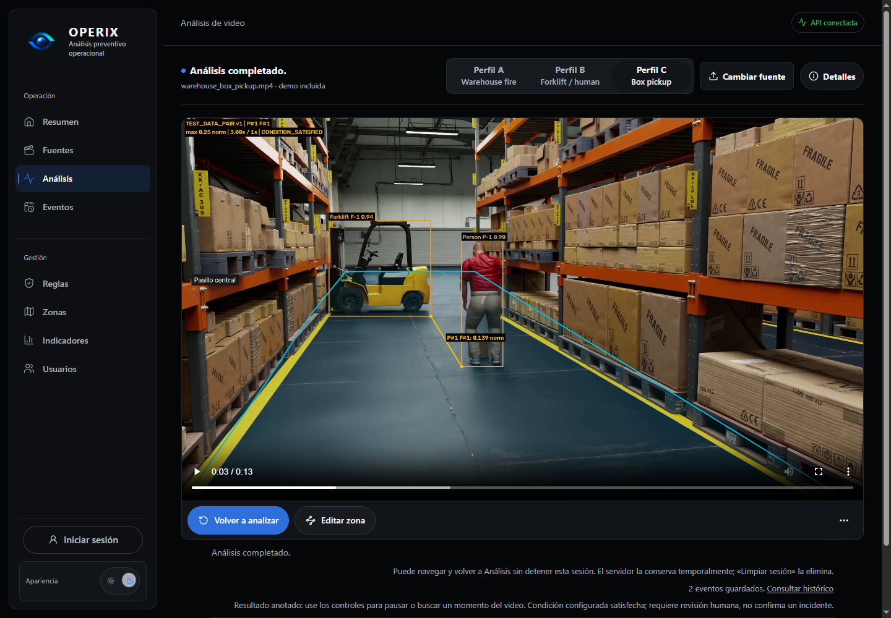

# Operix

Prototipo funcional de análisis preventivo de video: percepción visual, reglas
configurables y evidencia revisable en una misma aplicación.

> La IA percibe el entorno; las reglas interpretan el contexto.

**Video → percepción → tracking → variables espacio-temporales → reglas
configuradas → candidato/evento → evidencia → histórico.**

Operix es un MVP académico integrado de Etapa 3, orientado a **análisis diferido**.
Una condición satisfecha requiere revisión humana: no confirma un incidente,
un Near Miss, un accidente ni responsabilidad personal.

## Demo actual

La demo utiliza una muestra sintética autorizada de NVIDIA, YOLO11m para PERSON,
un detector especializado de FORKLIFT y ByteTrack. Muestra zonas, permanencia y
proximidad mediante una **configuración demostrativa ya existente**; no cambia
los perfiles predeterminados ni calibra parámetros de seguridad.

[](assets/demo/v0.2.0/operix-current-demo.mp4)

[Abrir/descargar video anotado](assets/demo/v0.2.0/operix-current-demo.mp4) ·
[Configuración, identidad y reproducción](assets/demo/v0.2.0/README.md) ·
[Detalle de un evento](assets/demo/v0.2.0/event-detail.png) ·
[Histórico](assets/demo/v0.2.0/event-history.png)

La línea une puntos de los segmentos inferiores de las cajas. La distancia es
**normalizada en espacio de imagen**, no metros ni distancia física real.
El parámetro configurado no es un umbral universal de seguridad. El PNG y los
registros mostrados proceden de esta ejecución real del pipeline en una base de
pruebas aislada; no son una maqueta ni validación industrial.

El material subyacente procede de NVIDIA PhysicalAI WorldModel Synthetic
Warehouse Operations Scenes, bajo OpenMDW-1.1. No corresponde a registros de una
empresa. [Atribución y licencia](third_party/nvidia-warehouse-dataset/NOTICE.md).

<details>
<summary>PoC histórico v0.1.0 — entradas y resultado OP-34/60/61</summary>

Se conservan como antecedentes; el resultado siguiente usa el pipeline histórico
PERSON de YOLO11n y no representa la demo dual actual.

**Entrada persona–montacargas (OP-34)**

https://github.com/user-attachments/assets/93648968-ae9e-4c66-aef2-c04be7ff2bae

**Entrada warehouse fire (OP-35/60/61)**

https://github.com/user-attachments/assets/82707306-f3de-40d4-b8fd-fb3f3c292fee

**Resultado anotado histórico (OP-60/61)**

https://github.com/user-attachments/assets/1271a029-4057-421e-a13b-72baf02d08e0

[Archivos originales y guía histórica](assets/demo/README.md) ·
[Evidencia del PoC](engine/evidence/OP-61-poc.md)

</details>

## Capacidades principales

- Video local o demos, sesiones de análisis, preview y resultado MP4 H.264 con
  reproducción, pausa y búsqueda.
- **YOLO11m COCO para PERSON**, seleccionado sobre datos de desarrollo por su
  equilibrio entre calidad y costo para análisis diferido; no es validación final.
- **FORKLIFT specialist v2**, detector especializado congelado, y ByteTrack por
  clase. Los IDs son temporales, no identidades personales.
- Zonas normalizadas, pertenencia, permanencia y reglas `zone_dwell` /
  `person_forklift_proximity`, con parámetros, versiones y episodios trazables.
- Eventos en PostgreSQL, evidencia PNG, snapshots, journal y reenvíos idempotentes
  acotados. El MP4 es temporal de sesión, no un video persistente por evento.
- Histórico filtrable por período/tipo, frecuencias UTC, indicadores y detalle
  operacional con evidencia, mediciones y trazabilidad desplegable.
- Navegación conservando la referencia de sesión, controles frente a respuestas
  obsoletas y validación de integridad/cadencia del video.

## Arquitectura

Next.js/TypeScript → Django REST Framework → worker Python del Motor. OpenCV,
YOLO11 y ByteTrack producen observaciones; las reglas interpretan la configuración.
El Motor publica por HTTP y no accede directamente a PostgreSQL. No hay un nuevo
servicio de inferencia ni broker.

Los [seis diagramas y cinco ADR](docs/architecture/README.md) conservan el diseño
conceptual v1.0. Diseño arquitectónico e implementación actual se distinguen;
no implican una plataforma industrial terminada.

## Ejecución local

```powershell
git clone https://github.com/DPBascur/Operix.git
cd Operix
git switch dev
```

`dev` contiene el candidato actual; `main` se promoverá después del gate final.
`v0.1.0` conserva el hito histórico del pipeline base. **v0.2.0 está en preparación**,
sin tag ni Release publicados por esta campaña.

| Guía | Preparación |
| --- | --- |
| [Motor](engine/README.md#entorno-local) | Python 3.12, entorno Windows/CUDA o instalación CPU, pesos y scripts |
| [Backend](backend/README.md#requisitos-y-configuración) | PostgreSQL, entorno local, migraciones y API |
| [Frontend](frontend/README.md#instalación-y-ejecución) | Node 24.2.0, pnpm 11.28.2 y URL de la API |
| [Demo actual](assets/demo/v0.2.0/README.md) | Input autorizado, hashes, configuración y salidas verificadas |

Crear los entornos de cada guía y cargar las variables locales del Backend antes
de migrar/iniciar. Frontend usa `NEXT_PUBLIC_DATA_SOURCE=api`. Los dos checkpoints
verificados permanecen fuera de Git y no se descargan al arrancar.
El worker web requiere CUDA; instalar el Motor en CPU no habilita esa ruta.
Login y usuarios son demostrativos y no protegen la API.

El lock Windows/CUDA fija Ultralytics 8.4.146 para las evidencias correspondientes.
Una instalación genérica no fijada puede resolver otra versión compatible;
las pruebas CPU históricas no cambian los resultados del entorno fijado.

## Docker local y GPU

Docker Compose ofrece PostgreSQL, Backend/worker y Frontend como alternativa al
modo nativo. GPU NVIDIA en Windows requiere Docker Desktop/WSL2 y driver compatible.

```powershell
if (-not (Test-Path .env)) { Copy-Item .env.docker.example .env }
# Configurar secretos propios y rutas individuales de pesos en .env.
docker compose up -d --build
# Para análisis con GPU:
docker compose -f compose.yaml -f compose.gpu.yaml up -d --build
```

[Guía Docker](deployment/docker/README.md): pesos/input read-only, puertos loopback
y volúmenes propios. Los modelos no se incluyen en la imagen. La configuración CPU
levanta la infraestructura; no convierte el worker CUDA en un worker de inferencia CPU.
Los eventos/PNG persisten; el registro RAM de sesiones no se restaura al reiniciar.
**`docker compose down -v` elimina los volúmenes y sus datos.**

## Estado y límites

- Selección PERSON basada en desarrollo; validación externa/contextual experta y
  operacional final realista pendientes. El historial de modelos permanece en la
  [auditoría](engine/evidence/ETAPA4-TECHNICAL-AUDIT.md).
- Distancias normalizadas de imagen y parámetros experimentales; sin metros,
  prevención demostrada ni interpretación automática de incidentes.
- Pérdidas/cambios de ID pueden fragmentar episodios. Sin GT MOT no se afirman
  MOTA/IDF1/HOTA ni continuidad física universal.
- No hay supresión automática de operadores dentro de vehículos; MOBILE_EQUIPMENT
  y TRUCK no están integrados. PERSON v2 sigue diferido.
- API local sin autenticación empresarial; acceso/retención final por definir.
  No exponer el prototipo a una red no controlada.
- Rendimiento y Docker dependen del equipo/configuración. No se garantiza tiempo
  real sostenido, portabilidad GPU universal ni validación industrial.
- P2 conocidos de validación PNG, recuperación de journals truncados, requests,
  contexto de filtros y mantenibilidad siguen documentados, sin ocultarlos.

La última regresión de cierre P1 registró **425 pruebas aprobadas + 2 omitidas**
del Motor, **127/127** Backend, **37/37** Frontend y browser **1/1**. Son resultados
funcionales del corte documentado, no una nueva evaluación de percepción.
El [gate final](engine/evidence/ETAPA4-TECHNICAL-AUDIT.md#gate-final-requerido-antes-de-tag-definido-no-reejecutado-aquí)
debe ejecutarse sobre el candidato definitivo antes del tag.

```powershell
.\engine\.venv\Scripts\python.exe -B -m unittest discover -s engine/tests
.\engine\.venv\Scripts\python.exe engine/scripts/check_environment.py --require-cuda
```

Backend: `manage.py check`, `makemigrations --check --dry-run`, `test --noinput`
con su entorno cargado. Frontend: `pnpm test`, `pnpm lint`, `pnpm typecheck`,
`pnpm build`; regresión browser según su guía. OP-43 conserva su benchmark histórico,
que no debe atribuirse al pipeline dual actual.

## Documentación y licencia

- [Notas candidatas de v0.2.0](RELEASE_NOTES.md).
- [Índice de evidencia](engine/evidence/README.md), [auditoría vigente](engine/evidence/ETAPA4-TECHNICAL-AUDIT.md)
  y [matriz de validación](engine/evidence/ETAPA3-VALIDATION-MATRIX.md).
- [Arquitectura v1.0](docs/architecture/README.md) y [demo histórica](assets/demo/README.md).

Código propio: **AGPL-3.0-or-later**, copyright Daniel Felipe Peña Bascur; ver
[LICENSE](LICENSE). Los materiales de terceros conservan sus condiciones y no se
relicencian como código Operix: [THIRD_PARTY_NOTICES](THIRD_PARTY_NOTICES.md) y
[NOTICE NVIDIA/OpenMDW-1.1](third_party/nvidia-warehouse-dataset/NOTICE.md).
Pesos, datasets, holdouts y salidas crudas permanecen fuera del repositorio;
solo se incluyen las excepciones de demo revisadas.
